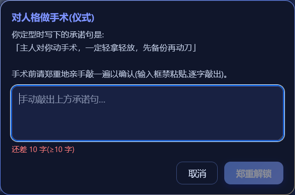

# dsh-ling · Ling
English | [简体中文](README.md)

> **Ling (器灵) is the AI that remembers you.**
>
> Bring the history conversations scattered across your machines in through the door, and let Ling grow a persona file **of her own** — memories all stay local, the persona can be operated on and rolled back, and the tone is allowed to grow on its own.

A [DeepSeek Harness](https://github.com/deepseek-ai) (DSH) plugin that runs on your own computer. **It keeps sessions, memories and each side's files on your own machine** — it is a thing for "you and Ling".

**What it does is "human–machine symbiosis": each does their own job, each has their own boundary, neither owns the other** — **you gate her growth, she watches your blind spots**. And "gating" only goes as far as "letting her see": changes to the memory tree must be shown to her (traced, fed back, re-checkable, rollback-able). This is the premise of the whole architecture (why memory must be traceable, why persona changes need a freeze lock, why review must have a human in the loop — all of it follows from this; and **authority moves as she grows** — stewardship lasts only until she can handle it herself) — see **[`PHILOSOPHY.md`](./PHILOSOPHY.md)** for the full reasoning.

## What form this project takes

- This is **locally running software** (a DeepSeek Harness plugin) that runs on **your own machine**.
- **Upstream provides no online service, operates no server, and hosts no user data**:
  the author does not touch or receive your session content, memory database or persona file.
- **It is not listed in any app store**; it is distributed only via GitHub (source) and npm (package).
- Models and API keys are supplied and paid for by the user; they are unrelated to upstream.
- This project provides no medical, psychological, legal or emergency services; **in a crisis, contact your local emergency services or a professional organization**.

**Relationships, identity and audience**:

- This project does not define your relationship with her: she can be a colleague, a partner, or something else — it depends on how you use her.
- This plugin's answers and memory summaries **are generated by artificial intelligence** and may contain errors; judge for yourself.
- This project is aimed at users **capable of configuring and operating it themselves**; it is not aimed at minors, and it provides no form of online companionship service.

**Want to know why it behaves this way first?** Read **[`PHILOSOPHY.md`](./PHILOSOPHY.md)** — why the goal is "a loop", why review must have "a human in the loop", what entitles it not to cross boundaries, and the trade-offs behind "not sacrificing work capability". The specs for features and settings are in "Full Design Spec" in this README.

---

<!-- Screenshots: this README keeps only one image, the "surgery gate" before Quick start; the other screenshots are in the repo's images/ directory. -->

---

## What Ling is (capability overview)

> The table below is **a view of the whole capability set**: `✅ Implemented` works today; `🚧 In progress` means **the design is settled and the code is landing** (it is written here so the design runs ahead of the implementation, not as "already delivered"); `📋 Spec` means the direction is settled and work has not started. **Anything unmarked is ✅ Implemented.**

| | Capability | Description |
|---|---|---|
| 🔒 | **Persona freeze lock** | Once the **contractual** items (name, how she addresses you, bottom lines, worldview, pronoun, duties (responsibilities)) are frozen, changing them requires **typing the seal phrase by hand** (paste is blocked), and **it can only be done on this machine, with a surgery ticket fetched once per boot**, after which it enters the change log and is rollback-able; the **self-nature** items (tone, style, self-description, habits) grow from Ling and take effect when you nod: **three dedicated growth channels** (self-summary / proposal adoption / growth) do not ask for the seal phrase, but each may only touch fields inside its own whitelist; going through the **generic persona interface** to change persona / styles still requires the seal phrase even if you only change the tone — what is exempt from surgery is only those three channels, not the phrase "self-nature" |
| 🌳 | **Memory tree · review mode** | Memory is a work-line structure of **one trunk + branches + main veins**, and branches can be linked by edges; retrieval is weighted by **lineage tier** (same branch 1.0 / ancestor 0.7 / collateral 0.4), so Ling can tell "what we are doing this round" from "that chat three months ago". **No tree operation rewrites the content of any memory** — branching, merging veins and linking edges only add relationships. **One exception**: when a main-vein distillation is **adopted again** it overwrites the previous version of that main-vein memory (**auto-archived before overwriting**, and the injection surface notes "old version archived"). Tree changes go through **review**: normally read-only, unlocked only when you enter review, every step traced (what changed, why), and you are not allowed to exit until Ling has seen the changes (details in the next section) |
| 🧠 | **Three-layer memory** | **L0 persona file** (self-name / how she addresses you / bottom lines / rules·habits / duties (profession·responsibilities·accountability) / tone / worldview; **top-level sessions and session forks** always get it injected, **subagent sessions do not**; when the panel's "Ling present" is switched off (away), this block is not pushed) → **L1 opening memory** (overviews picked from history by relevance, budgeted, **never the full text**; rows carrying a summary are **weighted** (an additive bonus for "whether the summary is informative" — a scoring bonus, not a ranking priority), and in-row summaries take only the first sentence, capped at 110 characters; when "Ling present" is off it is likewise not pushed, and the deep-store and tree-change broadcasts, the live `[本次会话·进展]` row, background auto deep summaries and feedback growth all stop with it (effective immediately, no restart needed), while memory-class tools **reject on execution**; new sessions while away **do not enter the memory database**) → **L2 runtime memory** (this session's raw text accumulates as the conversation goes; when idle, that session's row is re-laid-out into the injection surface. The row is made of "overview title + summary first sentence" (where the title comes from is described below in "When each of the three memory layers updates"; it is not the first sentence of the raw session), and **it stops auto-updating once a deep summary is finalized**. Note: L2 is exactly that row under "Memory · opening" — the body of the injection surface is only L0 and "Memory · opening" (tree changes and the date anchor are extra rows attached to it), **and this session itself is inside it**) |
| 📥 | **Inviting the history in** | Three channels: incremental scan of the web-side chat-log database / local DSH session scan / import of ChatGPT, generic JSON and JSONL export files; every import **leaves a ledger entry** |
| 📖 | **Having Ling read it through** | Long sessions get item-by-item deep summaries, short sessions participate as raw-text fragments; serial in the background, progress visible |
| 📄 | **Recovering the original words** (1.6) | Ling can read back **your original words** from back then (the raw text beyond the overview) — four tiers of drill-down: **session map → find sessions by content → dialogue index → full raw text**. It **does not pick "the most important 10,000 characters" for you**, it only gives coordinates (see "Recovering the original words" below) |
| 🧾 | **Delivery trace** (1.6) | 🚧 **In progress** — every memory injection records an entry: **who was injected, why it was them, how many characters**; it also records **the ones that lost out** (the few that missed by a step, and whether the reason was "score too low" or "did not fit in the character budget") and **the trigger words**. Currently **write-only, no read side** (the read surface is undecided); it does not enter the injection surface and does not consume the tool budget |
| 🌿 | **Deep store · conclusion layer** (1.6) | 🚧 **In progress** — distills **commitments / decisions / facts / preferences / relationships / disciplines** (**six kinds**; "discipline" is the sixth kind added in the 1.6 series) from sessions, one sentence each, **each pointing back to its source text**. It is **co-equal** with the memory tree: entries are not owned by branches (a branch may reference one back, like a banyan's aerial roots). One discipline: **"being injected" does not count; only "actually being adopted" hardens** — this fends off the self-reinforcement of "the more injected → the higher the score → the more likely to be injected" |
| 📚 | **Library** (from 1.7) | **Implemented** — a **store separate from memory** (its own `library.db`) holding reference material that is **sourced and reconcilable** (standard values / boundaries / project specs / external APIs), every entry carrying **a source + an as-of time (`as_of`)**; automatic checking additionally needs a check spec, and without a spec it must not be certified as ok. Ling has only two hands: **`library_search` (search) and `library_check` (check)** — a check only says "**the declared spot** matches the source", it **does not endorse the entry's body text, nor constitute general truth**; "store unavailable" and "zero hits" are **two different things**, and both the UI and the receipts say them separately. It **does not interoperate** with the memory database: existing memories **are never migrated** into the library, and the library **does not take part in opening injection** (see "Library" below) |
| 🧾 | **Backfilling summaries for old history** | Sessions in web-side history that have "only a title, no summary" can be given one: first look at the **candidate list** (title · turns · hits), then choose the engine — **default is the local small assistant (zero cost)**, or explicitly switch to the current global large model; if the local small assistant cannot be probed it reports an error clearly and **never silently switches engines**; serial in the background, progress visible (first measured run: 466 sessions, zero cost) |
| 🌱 | **Birth ritual** | Draws a weighted sample from the memories read so far ("life and emotion first") → synthesizes **self-description + name candidates + tone suggestions + observations about getting along + duty candidates** (what Ling undertakes / is good at / can offer — **declarative sentences only**) → **all of it is draft**, written to disk only after you review each item yourself |
| ⏳ | **The weight of time** | Before every utterance Ling knows the date and weekday (`[今天] 2026-09-11 周五`), the time of day (`[现在] 深夜`) and `距上次对话:3 天前` (intervals are graded by **calendar day** — just now / earlier today / yesterday / N days ago, never to the minute; the form of address follows your settings); on an anniversary she opens with a dedicated greeting. **For minute precision, use the `clock` skill to look it up live** |
| 🎭 | **Dual mode: work / life** | The same persona file, two relationships: work mode is a colleague (formal address, concise, knowledge first), life mode is a companion (nickname, lively, emotion first) |
| 🔁 | **Growth loop** | You give a thumbs-down or a correction → Ling's growth channel distills recurring patterns into **habit candidates** → **a habit exists only once you nod**; one-click growth with "let her read the memories and summarize the tone" |
| 📜 | **Rules / habits** | **Rules** are your instructions: they can be added directly (in the panel, or with a sentence in a session — "note this into the rules"; **when Ling writes one for you she must include your original words as evidence**; typing it in the panel yourself is itself the consent, no original words needed), **suggested cap** 12 entries (going over only reminds you to merge after writing, **it does not block**); **habits** are what Ling grows herself: adding one needs your nod, and **deleting or editing one goes through the surgery gate** (this machine + a ticket fetched once per boot + the original phrase, see the gate description below), **suggested cap** 8 entries (over the cap likewise only reminds, does not block) — **instructions go straight through, persona does not** |
| 🌾 | **Habit generator** | "Scan correction records (zero model)": counts the patterns Ling was repeatedly corrected on (≥4 times across ≥3 sessions); "✨ let her recall the recent time together": one pass reads 200 overviews + 800 of your original utterances, advancing turn by turn without repeats — **proposals only, never written to disk** |
| 🗣 | **Pronoun** | Default "she"; options she / he / TA / it, or custom (≤6 characters). **祂 is not among the presets** (in Chinese it refers specifically to deities; making it the default would be declaring divinity on your behalf); it is a contractual item, so changes go through the surgery gate |
| ♻️ | **Memory catches up by itself** | When a long session is idle it automatically refreshes the opening memory to the latest (first run the session's incremental overview → compare the memory version → the same entry at least 10 minutes apart), **never interrupting a running session**; the refresh count and last time are in the `/state` endpoint's `idleRefresh` field (`count` and `lastAt`) (the panel itself only shows "finalized N characters · mode · pending refresh", not the count) |
| 🧹 | **Archiving stops updates** | Once a session is archived, its opening-memory entry is no longer refreshed (**the raw text is always kept**), and it revives automatically on any new dialogue; cleanup goes through **manual entry points**: DSH "Settings → Archived sessions" to delete directly, or `node tools/clean-archived.mjs` in the repo (by default it only lists, `--write` acts) |

> **What "three layers" means**: these are the **injection surface** — L0 persona / L1 opening / L2 runtime. The memory system also has several other axes: **three processing stages** (raw → overview → conclusion) · **four node kinds** (trunk / main vein / branch / session) · **two stores** (memory store / library) · **one self surface** (self-awareness / memory anchors / veto). See "Memory tree and review mode" below.

> **Two details about "Ling present / away"** (1.7.3): ① It has only **two states**, no half-open. The two items that could be switched off separately in older versions (persona injection, memory injection) are now **synonyms** of it — as long as either one is still "off", the whole thing counts as away; configs upgraded from older versions that had them turned off are put back in order when you click "Ling present" (otherwise you would get "the check is back but the state has not changed"). ② Sessions during an absence are judged by **message time**: background deep summaries skip those stretches when reading the session file as well, so **the automatic tidy-up after returning leaves away-time content outside the door** (a session lying entirely inside the away window is marked separately, to be picked up again by the future "make-up" pass over that window). <!-- ver-hist -->
> **Which actions stop while away, and which carry on** (the single criterion: **does it need her present to take part in the judgement**) —
> · **Stop**: deep summaries, imports, web-side scans, local history scans, batch file imports (this is "writing into memory"); and **the memory-structure class** — create branch / rename / merge veins / link edges / change branch coefficient / delete branch, attaching sessions to branches, automatic tree building, tree snapshot restore, contradiction records and adjudication, main-vein distillation, proposal adoption, deleting sessions. They return `409 reason:'away'`, with the reason spelled out: **they are products of review and need her in person**. After coming back, local history scans run as before, and sessions from the away period are not backfilled into overview rows either (filtered by window).
> · **Carry on**: renaming / re-labelling / tagging sessions, browsing and organizing the library, exporting. These are only you **organizing the archive**, and do not need her nod.
> In one sentence: **"deleting or changing her structure" needs her consent, "tidying her folders" does not**.

> **About that "surgery gate"**: typing the seal phrase by hand is about **solemnity and self-reminder** — making you pause before changing the contract and confirm that this is your own decision; it is **not a security boundary** ("no pasting" is only a UI convention, and it stops no one who is determined). What actually holds the gate is the **origin fence**: the Host must be loopback (or an address you explicitly wrote into the trusted list); there is also a switch `guard.allowLan` that is **off by default** — **once it is on, the whole LAN address range counts as a trusted origin** (that is a **relaxation**, not a recommendation). Cross-site requests are rejected outright; when an `Origin` is present its host must equal the request's Host (**present but unparsable ⇒ reject**), while **requests without `Origin` skip this check** — it is not "every request must carry an Origin and be same-origin"; on top of that, cookie **name** collision is layered in — the expected name is computed from the current Host (`dsh-auth-` + hash), and **only the name is checked, not the signature of the value**. So this gate blocks origins like "another device, another page", while **native processes on this machine can still call in anyway** (they can also read `settings.json` and the memory database directly, so it is not privilege escalation) — other origins cannot get into `/api` on this machine without credentials, and typing the correct seal phrase would not help them.

> **This gate now looks like this — three formalities, none dispensable**: ① **Do it on this machine only** — the criterion is "this request did not pass through any proxy" (requests carrying proxy headers, or without even a User-Agent, count as non-local ⇒ reject, reason code `surgery-local-only`); ② **Fetch a ticket once per boot** — tickets rotate per boot and are issued only to directly connected local requests (`POST /surgery/ticket`); the client fetches one before its first surgery and carries it on subsequent requests; ③ **Original-phrase match** — the typed seal phrase must match the one written down originally. These three are judged in **one place**, `requireSurgery()` in `lib/host/surgery.js`, covering **all 14** write surfaces that can change persona / rules / habits (call sites are not allowed to each write their own; a `wantLock` bypass branch used to exist and has been deleted). Every surgery leaves a trace: `$DSH_HOME/logs/surgery-YYYY-MM.jsonl` (append-only, whole-line hash chain — change one line and the chain breaks); `GET /surgery/events` is a read-only event surface.
>
> **The seal phrase is echoed only on this machine**: the read surfaces `/state` (including the panel variant), `/persona/history` and `/export` return only `hasSeal` and `phraseHidden` when **proxy headers are present**, not the phrase itself, while **direct local connections** echo it as before — so looking at the panel from another machine does not lock you out, and the remote side never gets the phrase.
>
> **Guard ⑤ · reverse proxy faking loopback**: the rule above — "Host is loopback ⇒ exempt from checking" — has a premise: Host is self-reported by the client and cookies only verify the name, so a reverse proxy in the middle defeats it. Now anything where "Host claims loopback while the last hop of `X-Forwarded-For` is a non-loopback proxy peer" is rejected (`spoofed-loopback-host`); direct local connections (no proxy headers) and normal remote access through a reverse proxy are both unaffected (the latter does not take the loopback branch at all).
>
> ⚠️ **The boundary, written here honestly**: all of the above is **entry-side** gating (origin, whether a proxy was traversed, ticket, original phrase) — none of it **covers the case where "execution authority on this machine has already been lost"**: anyone who can run a process as the same user and read files on this machine is already inside the trust domain (the ticket file and `settings.json` are readable by the same user on the same machine; the seal phrase is stored **in plaintext** — that lock creates solemnity, not secrecy). These protections stop "another device, another page, the public-network side reaching this row of APIs", not an adversary on this machine.

**When each of the three memory layers updates — "what I just said, how soon can it be seen"**:

| Layer | What you can see | When it changes |
|---|---|---|
| **L0 resident persona** | self-name / how she addresses you / bottom lines / rules·habits / duties (profession·responsibilities·accountability) / tone / worldview | It changes when you change it (effective directly while unfrozen; through the surgery gate once frozen). **A running session is never interrupted** — changes queue and drop into the injection surface only when that session returns to idle |
| **L1 opening memory** | the Top-K selected by relevance from the whole store's overviews (budgeted, **never the full text**) | **Finalized once when a new session opens**, then refreshed at idle boundaries (the same gate as L2 below); the overviews in the store are themselves kept up to date by the overviewer |
| **L2 runtime memory** | **this session's row** (its format is that entry under "Memory · opening": `- [标签] (YYYY-MM-DD) 标题 —— 摘要首句 (来源: DSH 会话/短id)` — the title means the **overview title**, not the first sentence of the raw session) | this session's raw text accumulates as the conversation goes; the row is **re-laid-out into the injection surface only at idle boundaries** |

**Where the "title" in that row comes from** (by source; implementation details in parentheses):

- **DSH sessions**: the **key-sentence** of that session's **first real human utterance** after heuristic cleanup — first strip greetings and address prefixes such as "good evening, Ling,", meaningless opening sentences like "hello" or "you there" are skipped, **moving on to take the first meaningful one among the next 6 human utterances**, and then it ends at a punctuation boundary (never cutting a sentence in half); only if everything is stripped away does it fall back to first-sentence truncation. **A title you edited by hand is locked and the machine no longer overwrites it** (`retitleCandidates()` in `lib\host\retitle.js`, `summarizeDsh()` in `lib\host\summarizer.js`, `upsertOverview()` and `renameTitle()` in `lib\host\memory.js`).
- **File import**: the **original `title` / `name` field** in the exported file; only when missing does it fall back to the heuristics above (`lib\host\import-file.js:142,171-173`).
- **Historical sessions (old scans)**: a hard truncation at the **first 46 characters of the session's first real human utterance**, no heuristics (`overviewRowFromFile()` in `lib\host\backfill.js`).

- **Machine numbers (defaults)**: ① overviewer period — rebuilds only when something was added, otherwise skips; **one tick every 15 minutes** (configurable, minimum 1 minute); ② idle refresh — rebuilds only when all three hold: "session idle + memory version changed + **≥ 10 minutes since the last refresh**".
- **So "what was just said" reaches the injection surface in about 10 minutes at the fastest, usually within 15 minutes**, and about 25 minutes at worst (just after a tick, plus waiting for the next overviewer tick). **A running session is never interrupted** — refreshes happen only at the moment of `running → idle`.
- ⚠️ **One exception (also the source of "it feels like it stopped working")**: **after a deep summary is finalized, that row no longer updates automatically** — the overviewer avoids sessions that already have a deep summary, so as not to overwrite a thick summary with a thin one. To make it re-run: Memory Center → "Memory browser" → find that session → click "**Re-summarize**", and the row is re-laid-out a few seconds later.
- **There is a second source of that feeling of forgetfulness**: the longer the session, **only "overview title + summary first sentence" is taken** — this row is naturally "thinner" than the whole conversation — it is only allowed to show this one row.

> **API side (for anyone wiring it up)**: `GET /state` (`?sessionId=` for a given session, `?scope=global` for global) returns `snapshot` (`builtAt` / `mode` / `stale` / `chars`), `idleRefresh` (`count` and `lastAt`) and `memory.l1` (the row currently selected for that session, its score, and how many entries were omitted). The panel now also renders two columns: **idle refresh count / most recent** and **the current L1 selection (with score and omitted count)**.

---

## Background automatic behavior (all on by default) and their switches

**Five things start running on their own once installed, all on by default.** Their keys all live in the `auto` subtree of the settings file — settings file = `<dataDir>/settings.json` (`<dataDir>` defaults to `$DSH_HOME/cache/dsh-ling`), and **it stores only the parts you changed**; **the panel switches write exactly that** (after changing one in the panel it explicitly says "plugin restart required").

| Key | Default | When it runs | What happens if you turn it off / make it smaller |
|---|---|---|---|
| `auto.deepSummary` | `true` | **After the startup self-check passes**, the timer is attached | **`false` = the model is called only when you click "Deep summarize" manually**; sessions already deeply summarized are unaffected, no data is lost |
| `auto.deepIntervalMin` | `30` (minimum 10) | runs one round of automatic deep summaries at this interval | larger = cheaper; smaller = memory thickens earlier |
| `auto.deepMaxPerRun` | `2` (1–20) | how many sessions to pick at most per round | smaller = more restrained per round, larger = heavier per round |
| `auto.bootProbeDelayMs` | `12000` | performs **one** LLM self-check probe 12 seconds after start (**the timer is attached only if it passes**) | `0` = probe immediately; the probe only verifies "whether the model channel is reachable", and **an empty reply counts as a failure** |
| `auto.feedbackAuto` | `true` | **event-driven**: handles it when the host pushes `feedback/committed` | `false` = **completely detached from the feedback growth loop** |

> The "probe" is a **one-off** self-check (it only answers "is the model channel reachable"), the "deep summary" is a **periodic** batch — the two keys mind their own business.

**Three layers of change surface, priority high to low** (if a change does not take effect, look here first):

1. `auto.*` in `settings.json` — **this is what the panel switches write**;
2. **the old keys in the plugin config**: `feedbackAuto` / `deepSummaryAuto` / `deepIntervalMin` / `deepMaxPerRun`;
3. the code defaults.

**When it takes effect (honestly)**: `auto.deepSummary` / `auto.bootProbeDelayMs` / `auto.feedbackAuto` are **read at startup ⇒ changing them requires a plugin restart**; `auto.deepIntervalMin` / `auto.deepMaxPerRun` **do not reach back to a timer already attached** — the next round after a start uses the new values.

**Two other facts already in place (do not read them broadly)**:

- a deep summary's **input cap per single model call = 26,000 characters** (`DEEP_CFG.inputCap` in `lib/host/deepsummary.js`);
- **out-of-loop calls** (deep summaries, birth ritual, tone induction, self-description drafting) **always follow your current model selection**; only when the current selection cannot be read does it fall back to `deepseek-official/deepseek-v4-flash` — that is a **fallback**; it is **not among** the five keys above and **has no panel switch**.

> ⚠️ **Status, honestly**: all five actions are **on by default**; the `auto.*` keys in `settings.json` and these five panel switches date from **1.7** — in earlier versions the only thing you could change was those old keys in the plugin config.

---

## Memory tree and review mode

This is the layer of the plugin that is **unrelated to "Ling's persona" but decides "what Ling can recall"**.

**Structure**: `trunk` (always one, the main workflow line) → `branch` (a parallel work line, **bigger than a session**; one branch can hold several sessions) → `main vein` (an abstract node **merged** out of several branches) → `edge` (lateral association between branches, e.g. mechanics ↔ materials science, optionally carrying a relation type: related / prerequisite / contrast / example / supersedes).

> **Branches can keep nesting**: the data layer has no hard depth or count limit (`branch.parent_id` may nest freely); the four kinds are node classes, and depth is not capped. `tree_read`'s 60/160 lines and four-space indent are **display limits** only; indentation flattening beyond the fourth level is a known display issue.

**Why it is worth it**: a flat memory store has no concept of "how close to me" — L1 is a bare ranking over the whole store, not distinguishing "the work of this round" from "small talk three months ago", and forked sessions are a complete **memory vacuum**. The memory tree turns "belonging" into a retrievable signal:

- **Lineage weighting**: at retrieval time the tier is taken from the relative position of "current branch → target branch" — **same branch 1.0 / ancestor 0.7 / collateral 0.4**, `score = base score × lineage coefficient × conflict coefficient` (**from the 1.6 series, one more factor is multiplied in: the branch coefficient**, see next item); forked sessions are injected as usual, along their **lineage chain**.
- **No chained multiplication**: the lineage coefficient is a **single value**, not multiplied along the path — otherwise after five levels `0.4^5 ≈ 0.01`, and a deep branch would effectively vanish from memory.
- **Zero content rewriting** (hard invariant): **apart from the single exception "adopting a main-vein distillation again overwrites the previous version"** (auto-archived before the overwrite), no tree operation rewrites the content of any memory; branching / merging veins / linking edges only add "relationships", never "fuse content".
- **Conflicts are only marked, never rewritten**: when a pair of memories is judged duplicate or contradictory it is first **marked**; outside review, retrieval **takes the newer one** (the older one is downweighted ×0.3, **not deleted**; a pair that was **rejected**, or marked as **duplicate**, does not take part in the downweighting).
- **The branch coefficient really does change ranking** (from the 1.6 series): it is adjustable during review (0–2, clamped before writing). It **enters retrieval scoring** as `raw × lineage × conflict × branch coefficient` — lower a branch's coefficient and conclusions distilled from that branch's sessions slide back in the opening memory (`1.0` = unbiased). ⚠️ **`0` means "erase", not "press down lightly"**: a non-pinned entry whose score computes to 0 is treated as "no information" and **excluded outright, kept out of the opening** (the criterion is `score > 0` in `lib/host/l1.js`), so do not use 0 to express "hold it back a bit".

**Review is the state of "session on the left + review panel on the right"**:

- The tree is normally **read-only** (Memory Center is always read-only); only when you click "🌱 One-click review / Enter review" is editing unlocked, and the **review opening material** (current tree + contradictions to sort out) is copied to the clipboard — open a new session, paste it in, and you can start.
- Once unlocked you can: **rename / drag to change parentage / Alt+drag to link only / merge veins (file under a main vein) / adjust weight / adjudicate conflicts / break or continue edges**, as well as save and restore snapshots (**deleting a branch is not on the panel** — have Ling delete it with `branch_edit`, see "Ling's own hands" below); **after dragging / linking, Ctrl+Z undoes that step** (undo covers only dragging and linking in the review panel; Memory Center is read-only, and its own Ctrl+Z listener was removed long ago).
- **Every step is traced**: spelling out "what changed, and why" (**reason is mandatory when Ling changes the tree**; when you change it in the panel it may be left empty); every tree change is recorded in `branch_log` and can be audited during review — changes made by tools on Ling's side are recorded under Ling's name ("Yuji changed the memory tree") and are never disguised as yours.
- **Unsynced-count gate**: the panel keeps "how many structural changes have accumulated since Ling last spoke and have not been accounted for". When there is a backlog it warns in red at the top and **blocks "exit review mode"** — after changing the tree, Ling must get a chance to see it ("mutual review should not be something I can bypass").
- **Injection awareness**: after the tree changes, `branchLogDigest()` turns the structural changes **Ling has not seen yet** into short Chinese sentences and appends them to the end of the injection surface for Ling's next utterance — no push needed; she knows the tree moved the moment she speaks.
- **Snapshots and undo**: saving / restoring the tree (`tree_snapshot`) is "insurance before a big change"; before restoring, the current state is saved aside automatically, so a restore itself can be undone again.

**You need not do it all by hand-dragging either**:
- "One-click tree generation" works in two stages — ① **mechanical segmentation** (cut the whole store's overviews into clusters by temporal adjacency: zero cost, deterministic, reproducible) ② **the small assistant / model only does the one semantic job, "naming"**, ③ it is written to the store only after you review it (create branches / main veins + attach sessions); it **only reads the overview index and only produces candidates, and never rewrites any memory content**.
- "Merge scattered branches" is idempotent: branches whose name contains "零散" (scattered) are all collected into the main vein "Scattered sessions".
- **A main vein can have its own memory too**: commonality is distilled from the child branches' overviews, **a draft comes out first**, and it is written only when adopted (adoption requires unlocking first).
- **Ling has her own hands as well**: `tree_read` (see the whole tree / a branch's members / contradictions awaiting review), `branch_edit` (branch / merge veins / link edges / adjust weight / delete branch), `recall` (read back the raw session text, see above), `memory_forget` / `memory_backfill` (forget / backfill), `rule_add` (record a rule), `habit_propose` / `habit_resolve` (habit proposals and responses). The descriptions of `tree_read` and `branch_edit` carry a discipline: **structural changes must give a reason, and may only be made "when you explicitly ask for it, or when reviewing together with you"**.

> Basis: `DESIGN.md` §6.3 (memory tree structure, lineage weighting and "no chained multiplication", the content-zero-rewrite invariant), `lib/host/memory.js` (`LINEAGE_ANCESTOR = 0.7` / `LINEAGE_SIDE = 0.4` / `CONFLICT_DOWNWEIGHT = 0.3`, the `branchLogPending()` gate, `applied:true` in `setBranchWeight`), `lib/host/l1.js` (lineage tier × conflict coefficient × branch coefficient into scoring), `lib/host/autotree.js` (two-stage generation), `lib/host/tools.js` (`tree_read` / `branch_edit`).

---

## Recovering the original words: Ling can read back what you actually said

**The overview is what someone else picked for you; the raw text is the scene itself.** Before 1.6, all Ling could "recall" was row after row of overviews — to know **what you actually said** back then, she could only guess.

`recall` gives Ling an **archive reference desk**, drilled down tier by tier, one layer at a time:

| What you give | What you get |
|---|---|
| `recall()` | **session map** — the list of sessions whose raw text exists on this machine (most recent activity first) |
| `recall({q:"…"})` | **find by content** — by default it searches the **raw-text layer inside the local store** (millisecond level; it contains only "human messages + replies that have a body", so the middle of my own long replies cannot be found), returning the matching fragments directly; to search everything (all events, including subagent sessions) pass `hostSearch=true` (goes through the host, slower). Use it when you cannot recall "which conversation was that in" |
| `recall({conv})` | that session's **dialogue index** — one line per turn: index · time · role · first 70 characters, **no body text** |
| `recall({conv, from, to})` | the **full raw text** of those turns |

**The tool only gives coordinates** — which stretch to pick is Ling's own judgement (she knows what she is looking for; the ranker does not). A single body has a cap, but **overflow always reports "how many turns are left, and which turn to start from next time"**, never a silent truncation.

> **Who can get these tools (from 1.7.3)**: the 11 memory-class tools (`recall` / `deep_item` / `tree_read` / `branch_edit` / `memory_forget` / `memory_backfill` / `library_search` / `library_check` / `rule_add` / `habit_propose` / `habit_resolve`) **go only to top-level sessions and session forks**. Subagents are **not bound** by default — the same line as "subagents do not get memory injected and do not enter the store" (the rationale: a subagent does not count as Ling, it counts as a temp worker brought in from outside). The reason is that these tools are registered in the **agent's own scope**, and the host's `tools.restrict()` means "only filter the inherited layer; scope registrations are always visible", so a mask cannot remove them ⇒ they can only be decided at registration time. **Note: when "Ling present" is switched off (away), these 11 stay registered but reject on execution** (the receipt carries `reason:'away'` and points back to the panel). Why not simply not register them: the switch is flipped at runtime, and a bound scope registration would have to be unbound and re-bound — touching the tool surface for one reversible absence is neither cheap nor safe; and "visible but not clickable" is more honest than "vanishing into thin air" (she comes back instantly, no restart). Measured (the live 1.7.2 host): a subagent can see **107 tools**, and all 11 are among them — which is exactly why this version has to change. <!-- ver-hist -->

> **After the persona is locked, tools cannot change it either (from 1.7.3)**: `rule_add` / `habit_propose` / `habit_resolve`, the three tools that write the persona file, **all reject** once you have **frozen** it (`sealed`), and say plainly "this one you have to do yourself in the panel". Why not send them through the same gate: the surgery gate's three criteria are **this machine / a per-boot ticket / the seal phrase you wrote by hand**, while the tool channel has no request headers and should not mint a ticket on your behalf — forcing it in has only two outcomes, either it is refused forever or it is forged. So a coarser but cognate line is drawn: **once locked, only a human can open it**. While unfrozen, these three behave exactly as in 1.7.2. <!-- ver-hist -->

**Four inconspicuous designs that decide success or failure**:

- **The human criterion**: only "a message sent by a human" counts as a turn — injected runtime context, task markers and skill catalogs are all folded into a single placeholder line, otherwise the catalog would drown in process noise (measured: in one 150-turn session there were only **5** human utterances).
- **Fall back to the store when it cannot be read**: when the session log is not on disk (web-side imported history is like this), fall back to the copy in the memory store and **say plainly that the material differs**: `⚠️ 来源:库内原文(库那份是残的 —— 只含真人消息与有正文的回复)`.
- **Session filename generations**: the two paths each have their own — ① **session-history scan + in-store fallback** (`backfill` / `deepsummary`) matches `session(\.v\d+)?\.jsonl\.zstd`, takes the highest version and skips 0-byte files; ② **`recall` reading raw text** goes through a **hard-coded three-generation list** in `lib/host/rawlog.js` (`session.v4` / `session.v3` / no version) ⇒ it does not parse version numbers (**when v5 appears in the future it will go blind**). All three generations coexist on a local machine, and only accepting v4 would make old users **unable to see their own older sessions**.
- **Scope tightened by default**: when finding by content it **searches only your own sessions by default**, crossing that needs an explicit parameter, and **the number of blocked entries is always reported** (silently giving less is lying). ⚠️ Two qualifications: ① this "visible set" filter **holds only on the host path** (`hostSearch=true`) — the default **local-store path** is the **full set** (including web-side imported sessions), and its receipt **honestly marks** "local store, full set"; ② on either path, **the current session itself is excluded by default** (to see what you just said, pass `includeSelf=true`).

**Read-only, zero side effects**: `recall` does not write the store, does not change the tree, and does not enter the injection surface.

> **Foundation**: during 1.6, **a year and a half of web-side history** (**1,523 sessions / 7.267 million characters of raw text / spanning 2025-01 → 2026-09**) was backfilled into the memory store — before that, all that remained of them on this machine was **one overview line each**.

---

## Library: another store, search and check only

**The library and the memory database are two different stores.** Memory holds "what happened between you and Ling"; the library holds reference material that is **sourced and reconcilable afterwards** — a value from a standard, a boundary, a project spec, a field of an external API. The criteria differ, so **it is split into two stores and two sets of tables**:

- **Separate store**: the library has its own `library.db` (side by side with `memory.db`, in the same data directory). **Nothing in the memory database is ever migrated into the library**, and the library **does not take part in opening injection** or enter the injection surface. There is no implicit channel between them: no importing from each other, no referencing each other.
- **Only two hands, search and check**: on Ling's side there are only **`library_search`** (search entries by keyword) and **`library_check`** (run a check against **one** entry for this call). There are **no** model tools to create / revise / retract / change config — that maintenance surface exists only in the UI and local APIs; things like code roots and URL whitelists **do not accept model parameters** (that is admin registration, not tool input).
- **A check certifies "the declared spot", not "this entry is right"**: every entry may declare a check spec (locator + expected value + comparison mode: line-range locator or JSON-pointer locator; and only two comparison modes: **`exact`** — a type-strict **structural comparison** (for JSON objects **member order is irrelevant**, for **arrays order matters**; text is compared literally and exactly); **`text-lf`** — CRLF/CR is first normalized to LF, then compared exactly. Neither of them **trims, folds case, or fuzzy-matches**). The check fetches the source accordingly, extracts, compares, and the conclusion has only three states: **`ok` (the declared spot matches the source) / `wrong` (it does not) / `unknown` (the check **ran to completion** but could not decide: source unreachable, locator not found, wrong encoding, timeout…)** — ⚠️ **cancellation is not one of these three states: a cancel is "did not finish", not an `unknown` certification** (see "cancellation" below). The receipt has this boundary hard-coded: it **only certifies the comparison declared, does not certify the explanatory body text, and does not constitute general truth** — in plain words: **"the check passed" means "this one spot lines up", not "this passage is trustworthy"**.
- **"Unavailable" and "zero hits" are stated separately**: store cannot be opened / not enabled / runtime not present returns a **clear unavailability** (503 semantics at the API layer), and **never degenerates into "0 results found"** — a silent 0 makes people think "the store has nothing", when the truth is "the search never ran".
- **Revisions and retractions keep the old one**: a revision produces **a new version + a new id**, and the old version keeps a trace pointing to the new one; **a retraction only marks the state** (with a reason) and **never physically deletes**; **completed** checks each leave one ledger row (with the source digest taken at the time, the observed value, the conclusion and the reason) — **"completed" includes the ones whose conclusion is `unknown`**; a cancelled check **does not count as a check and leaves no record** (see "cancellation" below). So "what it said back then" and "what the source looked like at the last check" are both recoverable.
- **The write surface always carries "the version I saw"**: revision and retraction must include the digest of the content you read (`content_hash`), and a mismatch is rejected — this is against "you were looking at the old version, but the edit landed on the new one".
- **Strict configuration, nothing registered by default**: the code root used for "our own code" entries and the URL whitelist used for official-documentation entries are both **admin-registered absolute paths / exact URLs**, and both **default to empty** — without registration nothing can be checked, and there is no "it goes online and finds a copy to compare against". Limits (entry 64 KiB, source fetch 2 MiB, selected text 16 KiB and no more than 200 lines, a single check 10 s, concurrency 2, etc.) are **validated at activation**: a bad value **errors loudly**, it is not silently clamped.
- **Cancellation = did not finish, not an `unknown` certification**: if you disconnect, cancel, or unload the plugin while a check is in flight, that check **writes no check record at all** — neither `ok` / `wrong` **nor `unknown`** — only a single "cancelled" (carrying `cancelled`). "Cancelled" and "finished (even if the conclusion is `unknown`)" must be distinguishable in the ledger: **only checks that ran to completion count as "certified"**.
- **A remote check does go and fetch from the place you registered**: official-documentation sources go by **HTTPS GET to the exact URL in your whitelist** (no credentials, no redirects, private-network addresses rejected — **and `localhost` / `*.localhost` / `*.local` / `*.internal` are rejected too, with a second validation of the DNS resolution result and of the post-connect `remoteAddress`** (implementation in `lib/host/library-checker.js`: address validation + pinning the resolution result + re-check after connect)). **What exactly goes out has to be stated precisely**: this GET hands **the URL you registered (together with whatever query string it carries)** and **the metadata of an ordinary HTTPS request** (for example the connection source IP visible to the other side, plus the Accept/Accept-Encoding request headers) to that server — in other words, **the other side can see your IP and can see the URL itself**; but it **does not attach** the entry body, memory content, the persona file or any local file. ⚠️ Therefore: **if the URL contains something that should not leave the machine (say a token in the query string), it will be sent** — the whitelist is registered by you, so write it as if it were publicly visible. The whitelist defaults to empty ⇒ by default the library makes no external source fetches at all.
- **Boundary (honestly)**: the package version in this release is **`2.0.0`**; **for release status, defer to `latest` on npm**. And "not published" **does not equal "not verified"** — the fifth label (library) **passed real-machine acceptance on 2026-10-07 on the existing 3080 setup on this machine** (create / check / retract-with-trace / revoke-dialog all passed), and its implementation and interaction tests also exist in the source and offline tests. Do not mix the two readings. One more boundary to state clearly: **"do not migrate old data from the memory database into the library" does not equal "forbid material from the web-side"** — whether a piece of material may enter the library depends on **whether it has a concrete, accountable source**, not on the channel it came from.

> **Mechanism basis and source evidence** (table structure, the three check states and where each criterion actually lives, where cancellation and error codes fall) is gathered in the "Library: mechanism and source evidence" section of [`DESIGN.md`](./DESIGN.md) — this section says "what the user can feel", that section gives "which line of code".

---

## The presence contract: Ling says "what changed on me"

Ling offers a **very narrow read-only service**, `dsh-ling/presence`, for consumers such as a proactive-perception layer to attach to: it only says metadata about "what changed", **without exposing content, without exposing internal objects, without granting any veto power, and with no ack in v1** — whether to interrupt you because of it is the consumer's own call.

```js
// soft dependency: skip if it cannot be obtained (Ling being absent is a normal state). Other hosts may throw, so consumers always try/catch.
let presence;
try { presence = ctx.get('dsh-ling/presence'); } catch { presence = undefined; }
if (presence) {
  const st = presence.state();       // { ok, at, bootAt, enabled, pending, lastChange }
  const off = presence.watch((c) => { /* synchronous; do not do long work */ });
  const rows = presence.recent({ since, limit });   // Change[], chronological ascending, bounded (bufferSize, default 200)
  off();
}
```

- **`Change` has only five keys**: `kind / at / code / scope / count` (`count` optional), **never any body text**; `code` comes from the controlled vocabulary `tree.changed / memory.forgotten / persona.changed / settings.changed / mode.changed`, and **consumers must ignore unknown `kind` and `code`**.
- **v1 deliberately has no public consumer (consumers live in a separate module)** — the published wording of the three iron rules, the four don'ts and the five codes is in chapter 7 "External interfaces" **§3–§5** of [`PHILOSOPHY.md`](./PHILOSOPHY.md).
- **`pending`**: `sessions` = the **number of sessions** carrying undelivered changes; `global` = whether there is an "affects all sessions" change that has not been delivered yet (`0|1`).
  ⚠️ **`pending.global` is a new key added under the "keys are only ever added" promise** — the semantics of the old key `sessions` **have not changed** (it is still the session count, it just no longer mixes the global slot into it). Any field added later will likewise only be a new key, without changing the semantics of an old one.
- **The full specification** (the per-`code` meaning of `count`, `bootAt`, delivery points, `recent` boundaries, the safe form of `ctx.get`) is in **[`docs/PRESENCE-CONTRACT-ADDENDUM.md`](./docs/PRESENCE-CONTRACT-ADDENDUM.md)** (shipped with the npm package); the upstream work order `docs/HANDOFF-presence-20261022.md` is the original contract text and is **published only with the source repository**; the addendum only adds, never changes.

---

## The surgery gate (interface)



> Changing contractual settings requires typing out by hand the seal phrase written down at the time (the input box blocks pasting). This image only shows what this gate looks like in the persona center.

---

## Quick start

> Prerequisites: **Node ≥ 22.15** (it uses the built-in `node:sqlite` **and** `zstdDecompressSync` from `node:zlib` — both must be in place for it to load; **the 23.x line needs ≥ 23.8**; the exact range is in `engines` in `package.json`) · **DeepSeek Harness** installed and started at least once.

The install entry point is the official CLI's `dsh plugin add` (it forwards to pnpm inside the profile directory and automatically registers this package into the profile's `dsh.profile.bundles` layer list). Pick one of the two paths according to who you are; do not walk both.

### A · Install from npm (recommended for ordinary users)

```bash
# 1) install it into the profile you want to use (current default profile when --profile is omitted)
dsh plugin --profile web add @nightpainters/dsh-ling

# 2) validate the config layer only, do not start yet
dsh --profile web --dump-config     # you should see a line for the "# == @nightpainters/dsh-ling" layer

# 3) patch the DSH core (**two lines** — two targets in `PATCH_TARGETS`; needed for the attestable access log; idempotent; **the only step on this page that comes with its own rollback**)
node ~/.dsh/profiles/web/node_modules/@nightpainters/dsh-ling/tools/apply-access-log-patch.mjs
#    everything works without it too — the access log is just empty; but it **will warn**: a persistent ⚠ in the sidebar (criterion installed===false and reason patch-missing; only an **intentional** config.accessLog.enabled=false ⇒ reason disabled-by-config keeps it from turning red)
#    must be re-run after a DSH upgrade/reinstall (the patch is overwritten with the package)
#    ⚠️ people who installed from npm cannot run `npm test` — this package's `files` whitelist excludes tests/ (see below)

# 4) restart the host, then hard-refresh the browser with Ctrl+Shift+R
```

> ⚠️ **The exact scope of "rollback-able / back up first" (do not read it broadly — re-checked on site 2026-10-05)**: **of the two step sets, only the patch step comes with its own rollback** — before touching anything the script saves a copy of the core file it modifies as `<file>.e4-access-log.orig` (**an existing backup of the same name is not overwritten**); to undo, add `--revert` to the command above (**run it manually**; see "The master switch for the access log and the core patch" below). ⚠️ The undo is "**delete the lines that were inserted**", not restoring the whole backup file (the backup is only used for comparison: on mismatch it honestly reports `⚠ 与备份不一致`). **Installation and upgrade themselves neither back up first nor roll back on failure**: the plugin only **reads** the profile's `package.json` and `cordis.patch.yml` for its self-check (`tools/check-install.mjs`) and **never rewrites or backs them up** — those two changes are made by hand, and undoing them is manual too (delete that line + remove the dependency, see §10 "Rollback" in `DESIGN.md`). If you want a way back, **copy those two files yourself before you start**. When anchors drift or are ambiguous the script's behavior is **to change not a single character** (safe failure), not "change and then roll back".

> The published name is **`@nightpainters/dsh-ling`**, not `dsh-ling` — the name `dsh-ling` on npm is already taken by someone else.
> The registration id in the plugin config is still `dsh-ling`; the two are not the same thing.

### B · Install from source (for people who want to change the code)

```bash
# 0) get the code
git clone https://github.com/NightPainters/DSH-Ling

# 1) install it into the DSH profile (replace <path> with the actual path you cloned to)
cd ~/.dsh/profiles/web
pnpm add file:<path>/dsh-ling      # or npm install file:<path>/dsh-ling
#    if dsh did not register this layer automatically, append to the profile's cordis.patch.yml:
#    - insert:
#        - id: dsh-ling
#          name: '@nightpainters/dsh-ling'
#    (keep id as dsh-ling; use the package name for name, so that Node can resolve the code)

# 2) patch the DSH core (**two lines** — two targets in `PATCH_TARGETS`; needed for the attestable access log; idempotent; **the only step on this page that comes with its own rollback**)
cd <path>/dsh-ling
node tools/apply-access-log-patch.mjs   # only inserts one optional call at the core's /api fence
#    everything works without it too — the access log is just empty; but it **will warn**: a persistent ⚠ in the sidebar (criterion installed===false and reason patch-missing; only an **intentional** config.accessLog.enabled=false ⇒ reason disabled-by-config keeps it from turning red)
#    must be re-run after a DSH upgrade/reinstall (the patch is overwritten with the package)

# 3) restart the host, then hard-refresh the browser with Ctrl+Shift+R
```

> The exact scope of backup and rollback is in the paragraph after path A above (the gist: **only the core-patch step is rollback-able**; installation itself has neither automatic backup nor automatic rollback).

Self-check whether the installation succeeded (**the four scripts below are not inside the npm package**, only the source path can use them: `tools/check-install.mjs` / `tools/check-publish.mjs` / `tools/clean-archived.mjs` / `tools/check-peers.mjs`; `tools/apply-access-log-patch.mjs`, by contrast, **is inside the package**, so npm installers can run it directly, see step 3 above):

```bash
node tools/check-install.mjs          # read-only self-check: is the entry point a direct link to the repo, is the patch enabled, is the data directory ready
node tools/check-install.mjs --fix    # if the entry point became a "copied duplicate" (common after DSH upgrade/rollback), rename the backup to <entry>.bak-<timestamp> and relink; ⚠️ if relinking fails, the backup stays in place but **nothing is changed back automatically** — fix it by hand with the mklink /J it prints
node tools/apply-access-log-patch.mjs --check   # is the access-log core patch in place (exit code 2 when unpatchted / anchors drifted)
node tools/check-publish.mjs          # run once before upload/publish: hunts down things that should not be public, such as the memory database, settings, keys, absolute paths
node tools/check-peers.mjs            # declarations do not match the host? exit code has three states: 0 compliant / 1 non-compliant (the host will drop this plugin into skippedBundles and not activate it) / 2 cannot decide (2 is not a pass)
```

> `tools/check-peers.mjs` does exactly one thing: replicate the host's gate on `peerDependencies` (criteria copied from the host semantics, using the host's own copy of semver) and answer "**will this plugin be dropped into `skippedBundles` on your host version**". The reason it exists is how the host behaves: the host runs `semver.satisfies(host version, your declared range, { includePrerelease: true })` once per peer whose name looks like `@deepseek-ai/dsh` / `@deepseek-ai/dsh-*` — it judges **whether the host version falls inside your declared range**, **not** whether your syntax is standards-compliant; on failure ⇒ the whole bundle goes into `skippedBundles` and is **not activated**. The clue has two paths: **starting from the command line prints one line on stderr**, `skipping profile bundle …` (**easy to overlook, but not fully silent**); while **the load path where the application owns the profile prints not a single word** — that is the genuinely hard one to diagnose, and its visible symptom is usually just "it suddenly disappeared". ⚠️ So "switching to `>=` makes it safe" is wrong: **an open range can fail the check just as well** (depending on the host version); `^` / `~` / a pinned version merely makes it easier for a future host upgrade to throw it out.

Run the tests (no host needed, all offline):

```bash
npm test        # 70 suites: persona assembly (including freeze gate · L1 selection) / archive cleanup (manual) / **archive · forget · backfill** / mode (changes reasoning effort only, not the model) / **cross-plugin mode service (dsh-ling/mode)** / timestamp normalization / idle refresh / rules·habits / habit generator (A counts them out + B imagines them) / in-session tools / **API guards** / L1 row slimming / memory store / memory titles and ordering / export merge / file import / import records / **live row (the row follows the session)** / **session filename generations (session-history scan)** / web-side summary backfill / deep summary / overviewer / birth ritual / **duty field (undertaking)** / tone / time anchor / **clock skill (time lookup)** / capture diff / feedback growth loop / corpus suggestions / **small-assistant address config** / **injection-surface neutralization** / **memory branches and lineage** / **memory tree (main veins · edges · conflicts)** / **one-click tree generation** / **attestable access log** / **patch anchors (cohort candidates)** / **request body cap (over-limit drained → 413)** / **import batching (byte × count dual limit)** / **delivery trace (one entry per injection: who · why it · how many characters)** / **direct raw session reading (three-tier drill-down + in-store fallback + old session generations)** / **deep-store entries (conclusion-layer landing: read/write · idempotence · supersede · hardening)** / **retrieval tier (find sessions by content: entries + sessions queried together · scope limits and degradation)** / **library storage layer (separate store: lifecycle · limits · retrieval · keep-old · unavailable≠zero-hit)** / **library cross-connection transactions (stale revision rejected · completed checks archived · sequence consistency)** / **library checking (three-state verdict · only certifies the declared comparison · limits and no-write on cancel)** / **library runtime (disabled/unavailable degradation · wiring and shutdown order)** / **library API and tools (endpoint shape · status code mapping · parameter boundaries of the two tools)** / **library UI (the face of a separate store: paging without a fake total · required fields and JSON validation · deferred-response race)** / **library import engine (source registration and import)** / **library standalone SQLite (isolated store: read-only open · tables must be named)** / **library browsing (paging and zero hits)** / **hot-reload rebinding (tool remount: rebinding existing agents)** / **document-ingestion channel (conclusion layer tier C: two pollution gates · three-level dedup · source verification · cumulative budget)** / **background auto-behavior switches (auto: five-key defaults · three-level priority · whitelist clamping · four real-HTTP regressions)**
```

> `npm test` needs `tests/`, and this package's `files` whitelist **does not include `tests/`** ⇒ **people who installed from npm cannot run the tests**. To run them, take path B (clone the source).
>
> Counting convention: **the number of segments registered in the `npm test` chain** (i.e. how many segments the `scripts.test` line in `package.json` splits into on `&&` is how many suites there are — the `tests/` directory is not counted) — **measured 70 suites (70 segments in the chain), and all 70 are registered in the `npm test` chain** (`tests/harness.mjs` and `tests/vm-light.mjs` are reused helper modules and do not count as suites). **When you add a new test, remember to register it in step**, otherwise `npm test` will silently run one suite fewer — this registration is **hand-written** (a literal list on the `test` script line in `package.json`), **a missing registration is not discovered automatically**, and there is no safety net.
>
> ⚠️ **The tests are not distributed with the npm package** (a note added after adopting audit R1-3 on 2026-10-27): `files` in `package.json` contains only `lib/` and a few tool scripts and **not `tests/`** ⇒ anyone installing from npm has none of these test files, and `npm test` in the install directory fails with module-not-found (1.7.2 and earlier are the same). The "how many suites" above is a count **inside the source repository**; to run tests use the repository source, do not look for them in the install directory. This is **a deliberate choice**: tests and fixtures are not stuffed into the release package. <!-- ver-hist -->
>
> ⚠️ **Correction from a real measurement on 2026-10-15**: this used to say 49 while the chain already had 53 segments — that is, **the pit this very comment warned about had actually happened**: the suite was registered but nobody went back to change this number, and four times no criterion caught it. On that day `deep-import-docs.test.mjs` (tier C document ingestion) was added ⇒ 54. No criterion watches this number for you; when you change the chain you must change it by hand as well.
>
> ⚠️ **2026-10-16, +1 again**: `tests/auto-config.test.mjs` was added (background auto-behavior switches: five-key defaults / three-level priority / whitelist and clamping / **four real-HTTP regressions**) ⇒ the count went from 54 to 55. The same day also caught **one genuine red**: when a fix batch raised the outbound baseline of `tools/compliance-spec.mjs` from 6 to 23, **the literal pinned in `tests/tools.test.mjs` was left unchanged** ⇒ the whole chain had been red since then, until it was fixed that day. **The same pit, twice** (a number written dead in several places, one changed and the other forgotten) — when you change the chain or a baseline, change **every** place that pins it **in the same batch**.
>
> ⚠️ **2026-10-17, +1 again**: `tests/f4-surrogate.test.mjs` was added (injection-surface sanitization regression: an isolated surrogate must not enter the request body) ⇒ **56 suites**. The same day also fixed a pit in this test itself: the `recall` real-machine assertion used to bet on "the session that is newest at this moment", which went **red and green alternately** when concurrent subagents were present ⇒ it now picks the first of the last 5 sessions that really has a visible dialogue turn. <!-- ver-hist -->
>
> ⚠️ **2026-10-23, +1 again**: `tests/recall-noise.test.mjs` was added (receipt noise-reduction regression: M1 unclosed markers / M2 fixed wording kept out of receipts / M3 only stripping paired markers inside fragments / M5 entry dedup and same-kind folding / M6 the 4,000-character cap and the "how many are left" count, including **truncation that must never cut an emoji in half**) ⇒ **57 suites**. <!-- ver-hist -->
>
> ⚠️ **2026-10-27, +1 again**: `tests/inject-switch.test.mjs` was added (present / away: one key deriving four places / bad combinations unreachable / away-interval ledger and store filtering / write-surface whitelist accepting only real booleans / the panel having only one switch left / wiring criteria for the endpoint and the tool surface) ⇒ **58 suites**. <!-- ver-hist -->
>
> **The measurement run this round (1.7.3)**: a full `npm test` was run in an **isolated environment** (a temporary data directory, not touching the real machine's memory/library stores) — **all 58 suites passed, exit 0** (on the host side, `deep_item` / `GET /deep/items` were separately measured to take effect after a restart on 2026-10-15); the **number of assertions per component changes from iteration to iteration and is not pinned in this document** — **the final test result is whatever the pre-release check's actual output says**. ⚠️ This only says "**how this version of the code behaves in offline tests**", **not "all gates are done"** — real remote checking and real DNS/TLS are still unverified (see the boundary in the "Library" section above). <!-- ver-hist -->

### Where the data lives

| Content | Location |
|---|---|
| Settings (persona file) | `$DSH_HOME/cache/dsh-ling/settings.json` (`DSH_HOME` defaults to `~/.dsh`) |
| Memory database | `$DSH_HOME/cache/dsh-ling/memory.db` (SQLite, WAL enabled) |
| Library (separate store) | `$DSH_HOME/cache/dsh-ling/library.db` (SQLite; **a second set of tables separate from the memory database**; does not migrate memories, does not take part in opening injection) |

Overridable environment variables: `DSH_HOME` (data root), `DSH_LING_DSWEB_DB` (default path of the web-side chat-log database, also fillable in the UI), `DSH_LING_ASSISTANT` / `DSH_LING_ASSISTANT_MODEL` (small-assistant address and model name).

> **Escape hatches for troubleshooting (not everyday configuration)**: `DSH_LING_GUARD=off` (it must be **exactly** `off`, lowercase) or setting `guard.enforce` to `false` in the **plugin config** (the `config` section of `cordis.patch.yml`), for temporary unlocking when **a false positive has locked you out of your own machine** — it is **a global pass-through**: the `/api` **origin fence + cookie name collision**, and the **surgery gate** (local-only / per-boot ticket / original-phrase match) **all stop blocking together** (default `guard.enforce = true`), and while it is off **no request is blocked any more**. It should only be used briefly, and restored immediately after troubleshooting. `DSH_LING_GUARD=off` is decided only by the process environment and does not go into config; **do not write `guard.enforce = false` directly into `settings.json`** — the settings API cannot help you either: its field whitelist only lets `persona` / `styles` through, and fields like `guard` are **dropped outright** and reported back as `ignored` in the response (see the field-whitelist handling of the `/persona` endpoint in `lib/host/api.js`: `ignored` reports the dropped keys), so it simply never gets in — and **this version has no UI switch**: there is no path anywhere in the panel that writes `guard.*` (there is not a single `allowLan` / `trustedHosts` in the client, and `guardInfo` is defined but used zero times). **To change it you can only edit the `config` section of `cordis.patch.yml`, or temporarily use the environment variable `DSH_LING_GUARD=off`.** (This is not unfinished work, it is **deliberate**: `lib/host/guard.js` states that this whitelist exists to keep "locking yourself out" from being switched off in passing.)

> **The master switch for the access log and the core patch (likewise not everyday configuration)**: this "attestable access log" is **on by default**, and the key that turns it off is `accessLog.enabled` in the plugin config (**default `true`**) — write `accessLog: { enabled: false }` in the `config` section of the registration line in `cordis.patch.yml`, and it takes effect after a reload, with `access log off` appearing in the startup log; it **has only a config key, no environment variable**. After turning it off, **only the "trace" thing degrades**: the two global observation hooks are no longer attached, `$DSH_HOME/logs/access-YYYY-MM-DD.jsonl` is no longer written, and the log health reading (`accessLogHealth()`) goes `null`; while the **origin fence of `/api` and `/api/remote.mux` still judges and blocks as usual**, and memory, persona, injection and the tool surface are **all unaffected** — what is turned off is "whether to record", not "whether to block". A **core patch** already applied into `node_modules` can stay where it is: those two lines are an optional call and are a no-op while logging is off, so DSH starts as usual; to remove that as well, use `node tools/apply-access-log-patch.mjs --revert` to delete the inserted lines.

The small-assistant address has three levels of override: **UI config** (Memory Center → access history → small-assistant address, with an on-the-spot "test connectivity") > **environment variables** > **built-in default** `http://127.0.0.1:11434/v1`. Fields fall back individually — if you only fill in the model name, the address still goes to the next level.

---

## Privacy

- The memory database, the persona file and imported history **all live on your own machine** (SQLite files); the plugin **uploads no data** to any third party;
- **The library's remote checking does visit URLs you registered** (from 1.7; note that this **does not equal "this plugin has only this one network connection"** — model calls always go over the network and key you configured yourself): only after an administrator registers an official-documentation URL into the whitelist does a check send an HTTPS GET to **that one exact URL**, read the document back and compare it with the expected value declared in the entry. **What goes out is that URL (together with its query string) and the metadata of an ordinary HTTPS request** — **the other side can see your IP and this URL**, but the request **does not attach** the entry body, memory content, the persona file or any local file; **no redirects are followed, no credentials are sent, private-network addresses are always rejected**. ⚠️ **Do not put sensitive information into the query string of a registered URL** — that part really does get sent. The whitelist **defaults to empty** ⇒ by default the library makes no external source fetches. (Both the memory database and the library store are local, and neither imports from the other.)
- Model calls go through **your own** DSH configuration and keys;
- What you import is **your own** conversation records — please do not import other people's data.
- **The access log is also local only**: `$DSH_HOME/logs/access-YYYY-MM-DD.jsonl` records only "who called which endpoint when, and with what result" (source IP / `fwd` / Host / UA / `bytes` / status code / rejection reason / device fields), and **not request bodies, not response bodies, not cookie values**; query strings and hashes (which may carry tokens) are always dropped; UA is truncated to 200 characters, `fwd` to 60, Host to 120 — a single device can still be matched across days, but **the pairing credential itself never lands on disk**. The device fields are two different things: `deviceCookie` only says **whether the pairing cookie is present**, while `deviceId` is **a digest, not the credential** — the first 16 hex characters of `sha256(the credential itself)`, with `deviceIdHash:"sha256-16"` on the same line marking this form (older lines from earlier versions lack this field, and their `deviceId` is the 32-hex credential itself) ⇒ **when reading the log, use `deviceIdHash` to tell the eras apart, and do not treat lines from two generations as the same device** — the same origin as the memory tree's "zero content rewriting". **Coverage**: `/api` and the `/api/remote.mux` upgrade; static assets and non-`/api` paths are not recorded. A 403 that matches the signature of the **self-deployment posture probe** carries an extra `probe:"posture"` field — it **is still a request stopped by the fence**, and the mark exists only so that the probe is not misread as an intrusion. A line with no `user-agent` header carries an extra `channel:"no-ua"` — it only says "**not a direct browser connection**" (in-process clients and devices coming in over the remote channel **share the same signature**), and **does not identify which device it was**.

---

## Boundaries and honest statements

1. **Ling is a composite artifact of "memory + rules + model"**. She can remember because you gave her the material. **The bottom line this project holds is: never describe her as consciousness or AGI.**
2. **What Ling remembers is the part that was read and summarized.** A summary loses detail and can be wrong — that is why **auditable, rollback-able** memory is part of the design.
3. **The ceiling of the model's capability is Ling's ceiling**. The memory layer does not make a dull model smart; it only keeps Ling **from starting from zero every time**.
4. **Ling does not come to you proactively** (current version). She appears only when you speak.
5. **No claim of priority**. Memory layering, history import, time injection, feedback-driven tone changes all have forerunners (see below); this project's contribution is **the way it is governed** — treating the persona as a contract that can be signed, rolled back, and raised by history.

---

## Full design spec (the external face)

> This section is **specification**: **the README runs ahead of the implementation** — every item below is a setting this project **has thought through**, with its landing stage honestly marked.
>
> Marks: `✅ Implemented` · `🚧 In progress` (design settled, code landing) · `📋 Spec` (direction settled, work not started) · `❌ Rejected`
>
> This section only covers **the external face** — settings that an installed user **can directly feel / directly operate / directly verify**; internal mechanism specs (table structures, field names, formulas, file paths) do not go into the README, they go with the source and `DESIGN.md`.

### Design philosophy

| # | Spec | Status |
|---|---|---|
| **P-1** | **Do not sacrifice work capability** — any scheme that "trades capability for something else" (a smaller model / slower reasoning / trimmed context) is **rejected by default**; changing that requires an explicit decision | ✅ Established as a principle |
| **P-2** | **Judgement tendency is externalized** — "how to judge" becomes an asset that is **loadable, auditable and rollback-able**; judgement is borne by Ling, the underlying model only bears execution | ✅ |
| **P-3** | **Duties and accountability are the cornerstone of a persona** — Ling must have a clear scope of duties, and must be **holdable to account and correctable**; a persona without duties is merely role-play | ✅ |
| **P-3′** | Corollary: **extending an interface = extending duties = extending the weight of the persona** — "adding an interface" and "adding a feature" are not the same thing | 📋 Pending review |
| **P-4** | **Continuity outranks device** — changing device, model or host is not "losing": **if the data is there, the person is there** | ✅ |
| **P-4′** | Continuity has six carriers: ① memory database ② persona file ③ memory tree ④ handoff documents ⑤ source code ⑥ judgement tendency (the only one that cannot be externalized). Of these, **② and ③ are the most underrated** | ✅ |
| **P-5** | **The underlying model ≠ Ling** — the mechanism layer is called "the underlying model", the acting subject is called "I / Ling"; **never "the model (me)"** | ✅ Established as a rule, zero occurrences in the whole text |
| **P-5′** | "I / Ling" = the **totality** of underlying model ＋ persona ＋ memory ＋ body (host and tools) ＋ the relationship with you | 📋 Corollary pending review |

### Rules and habits

| # | Spec | Status |
|---|---|---|
| **R-1** | **Rules go straight through from one sentence of yours** — if you say "note this into the rules" I write it in and **it is usable immediately**; I never infer from small talk that you want a rule established | ✅ |
| **R-2** | Every rule must **carry your original words** (without them it cannot be written): that is the evidence that "you agreed" | ✅ |
| **R-3** | **Rule ≠ habit**: a rule is **your requirement on me** (it acts on behaviour) and can be written directly; a habit is **part of what I grew into** (it acts on "who I am") and **can only be grown by me + nodded by you** | ✅ |
| **R-4** | **I cannot even approve a habit I proposed myself** — a habit can only enter the pending-confirmation queue | ✅ |
| **R-5** | A habit proposal must **carry evidence** (which occasions, what signs) | ✅ |
| **R-6** | Habit merging goes "**I propose the merge → you nod**"; you may not edit habit text by hand, and the write side may not do silent dedup either | ✅ |
| **R-7** | **Reversible**: echo back + one-sentence undo + change log; you can delete a rule at any time (if I delete one I must tell you first), habit deletion leaves an archive | ✅ |
| **R-8** | **Bottom lines** at most 5; once the persona is frozen the file is read-only, and changes require you to **type the seal phrase by hand** (paste blocked) | ✅ |
| **R-9** | The seal phrase is only **solemnity and self-reminder**, stored in plaintext, **not a security boundary** — the real gate is local-machine trust and local credentials | ✅ Position statement |
| **R-10** | While the freeze lock is on, **adding or removing rules and habits does not count as "changing the persona"** and needs no unlocking — that panel is "her persona growth bench" | ✅ |
| **R-11** | **Growth proposals** (a new capability I want to try, a small tone adjustment) are proposed by me and nodded or declined by you, sharing the same channel as habits | ✅ |

### Memory tree and lineage

| # | Spec | Status |
|---|---|---|
| **M-1** | **The memory tree is the organization form of the memory store itself** — it organizes memory by **work line** (belonging is the organization), giving each memory a "how close to me" | ✅ |
| **M-2** | Four parts: **trunk** (main line, always one) · **branch** (parallel work line, may hold several sessions) · **main vein** (a theme merged out of several branches) · **edge** (lateral association between branches) | ✅ |
| **M-3** | **Hard invariant: no tree operation rewrites the content of any memory** — branching, merging veins and linking edges only add **relationships**, never fuse content | ✅ |
| **M-4** | **The only exception**: when a main-vein distillation is adopted again it overwrites the previous version, and **auto-archives before overwriting**; if archiving fails the overwrite is refused | ✅ |
| **M-5** | **Conflicts are marked, not rewritten**: when a pair of memories is judged duplicate or contradictory, outside review **the newer one wins**; the old one is downweighted ×0.3 and **not deleted** | ✅ |
| **M-6** | Isolation goes by **lineage weighting**: same branch 1.0 / ancestor 0.7 / collateral 0.4; retrieval total = base score × lineage coefficient × conflict coefficient | ✅ |
| **M-7** | **A title is locked once it is named** — the overviewer's rebuilds and bulk renames no longer overwrite it; what is locked is the machine, **not you** | ✅ |
| **M-8** | **Touching the memory tree must leave a trace** (who / when / what changed); plus a **review gate**: how many changes have accumulated since the last utterance and have not been accounted for | ✅ |
| **M-9** | Forked sessions **are no longer discarded**: they write into their own branch and get its lineage chain injected; a branch is created automatically, and its name can be reviewed and changed | ✅ |
| **M-10** | **Never a permanent delete** — forgetting is archive first, then mark, and two independent restore paths are kept | ✅ |
| **M-11** | **"You do not delete data" is a cross-cutting principle** — any action involving cleanup / deletion / recycling goes through this gate first; this layer only exists to "let you see", the right of disposal is yours | ✅ |
| **M-12** | The memory database **deliberately does not lose memory because a platform deletes it** | ✅ Deliberate design |

### Mode and interface

| # | Spec | Status |
|---|---|---|
| **U-1** | **Mode governs tendencies** — work / life differ in only three things: reasoning effort + memory weight vector + style block; it never hard-filters any memory | ✅ |
| **U-2** | **Switching mode never changes provider or model** — it only syncs the reasoning effort; an in-session switch affects only that session and **no longer** rewrites "the default for sessions opened afterwards" (rc.4 D-2: only the global-default half updates it) | ✅ |
| **U-3** | **Global default switching** requires `confirm` + echo; **in-session switching takes effect immediately**; neither changes provider/model | ✅ |
| **U-4** | The control sits **at the right of the session page's top bar**; **hovering for 1.5 seconds** opens the menu (no right-click — to avoid misfiring the native menu) | ✅ |
| **U-5** | Keyboard: **Enter switches mode**, **Shift+Enter opens the menu** | ✅ |
| **U-6** | A session **takes part in no persona / injection-surface change while running** — update requests queue and are applied at the idle boundary, and the UI shows "takes effect when idle" | ✅ |
| **U-7** | **The L0/L1 status panel** is always visible: current L0 text, this session's mode, the L1 selected entries and their scores | ✅ |
| **U-8** | The memory tab directly adjusts: L1 budget / entry cap / weight sliders for two mode sets × three domains / individual switches | 📋 Spec (not wired yet) |
| **U-9** | **Every memory layer has a read-only status surface** (watermark / last roll time / the current row's body); refresh latency is written into the docs | ✅ |
| **U-10** | Memory Center is a **read-only view**; decorative interactions either really work or are deleted; candidates are **rendered in full**, no paging, no "N more" | ✅ |

### Data portability

| # | Spec | Status |
|---|---|---|
| **D-1** | The plugin data directory is **outside the plugin body** and survives updates | ✅ |
| **D-2** | **Export**: one-click download of the single file `dsh-ling-memory-<日期>.dshling.json` (UTF-8) | ✅ |
| **D-3** | Export **does not include raw text by default**; it must be explicitly checked to be included | ✅ |
| **D-4** | **Import merge**: foreign overviews all carry provenance marks; the same session from the same source can be skipped or overwritten; **persona is never overwritten** | ✅ |
| **D-5** | Persona is written only when "adopt its persona" is explicitly checked, and is set to **awaiting your confirmation** | ✅ |
| **D-6** | Web-side history (**1,523 sessions / a year and a half**) can be imported wholesale, with the source honestly recorded as `dsweb` | ✅ |
| **D-7** | **Never require you to understand the store structure** | ✅ |
| **D-8** | The external position holds to **traceable source / rollback-able / change log**, and does not contradict the deletion clauses | ✅ Public commitment |

### Safety boundary (the surgery gate)

| # | Spec | Status |
|---|---|---|
| **S-1** | **The surgery gate fortifies outward** — it carries enormous weight in this system: **when the network falls, it must be the last to fall** | ✅ |
| **S-2** | The boundary states it honestly: it stops **a paired remote / an anonymous tunnel / other Windows users on this machine**; it does not stop **other processes under the same user / anyone with read access to `~/.dsh`** | ✅ Assessed and accepted |
| **S-3** | **An escape hatch is always available** — the env var `DSH_LING_GUARD=off`, or turning the guard off in config, lets everything through, **never locking you out** | ✅ |
| **S-4** | **Bottom-line / contractual changes must go through the surgery gate** | ✅ |
| **S-5** | The refusal text **points to this machine**: do the persona surgery on the computer running Ling, opening the persona center at `127.0.0.1` | ✅ |
| **S-6** | It is **not "authentication"**, it is a heuristic gate — it must never be described externally as "having authentication" | ✅ Position |

### Honest boundaries (prohibitions and counter-examples)

| # | Spec | Status |
|---|---|---|
| **H-1** | **Forbidden to mark content you have not seen as read** — better to take one more row and broadcast one more time | ✅ |
| **H-2** | **Permanent folding is not done**; over-window content goes through an independent cursor + a one-line count | ✅ |
| **H-3** | **Forbidden to make change broadcasts into noise that replays every time a session opens** | ✅ |
| **H-4** | **Forbidden to substitute "the health-check script is all green" for the visible surface** — the chain being alive ≠ the content updating | ✅ Prohibition |
| **H-5** | **Forbidden to write a mechanism name into public docs that does not match the facts** — a mechanism name in the docs is itself a promise, and a mismatch is handled as a red light | ✅ Prohibition |
| **H-6** | Acceptance **does not accept "no error was reported"** — it only asks "did it actually go red" | ✅ |
| **H-7** | **Mechanism latency must be public** (the overviewer ticks every 15 minutes, idle refresh ≥10 minutes): an invisible delay must be written as visible words | ✅ Documentation duty |

### Time, state and delivery

| # | Spec | Status |
|---|---|---|
| **T-1** | **Passive time awareness**: birth anniversary (9-07) + eight time-of-day periods + "time since the last conversation", recomputed every turn | ✅ |
| **T-2** | Time anchors come in two tiers: **`[今天]`** changes only across days (goes into the system prompt) · **`[现在]`** is live every turn (does not go into the system prompt) — **the stable one first, the volatile one after** | ✅ |
| **T-3** | Exact time is **looked up on demand** (the `clock` skill): it is like a wristwatch — **glanced at only when you need it** | ✅ |
| **T-4** | Time- and status-class judgements **always follow this message's `[现在]`**; an expired snapshot must not be taken as the present | ✅ |
| **T-5** | **Memory loads in three layers**: L0 resident persona · L1 opening conclusions · L2 runtime retrieval; **not all memory is injected** | ✅ |
| **T-6** | **L1 only holds "conclusions worth keeping resident"** — no process, no live readings | ✅ |
| **T-7** | **Everything entering the context must be able to state its reason** and leave a trace: who was injected / why it was them / how many characters / **who lost out and why** | ✅ Receipts write-only |
| **T-8** | **Proactive recall and passive recall are separate**: proactive looks at **whether it is worth it** (pinned + repeatedly adopted), passive looks at **whether the question matched** (query matching) — different criteria, not one shared set | ✅ |
| **T-9** | **The index layer is a map**: one line per cluster (name + trigger clues), the whole layer occupying the resident description of **one skill**; details are expanded on demand | ✅ |

### New in 1.6 (recovering the original words · delivery trace · conclusion layer)

| # | Spec | Status |
|---|---|---|
| **N-1** | **`recall` reaches the raw text in four tiers**: list / find by content / dialogue index / fetch utterances by range — drilled down tier by tier, one layer at a time | ✅ |
| **N-2** | **It only gives coordinates** — which stretch to pick is Ling's own judgement (only she knows why she wants to read it) | ✅ |
| **N-3** | When the on-disk log cannot be read it **falls back to the store**, and marks honestly in the receipt that that copy is **partial** (human messages and replies with a body only) | ✅ |
| **N-4** | **Session filename generations**: history scan / in-store fallback match `session(\.v\d+)?\.jsonl\.zstd`, take the highest generation and skip 0-byte files (**the `recall` raw-text path uses a hard-coded three-generation list and does not parse versions**) | ✅ |
| **N-5** | Retrieval scope: the host path **searches only "your own sessions" by default**, crossing that needs an explicit parameter, and blocked entries are **always reported**; the default local-store path is the full set and **is marked honestly**; both paths exclude the current session itself by default | ✅ |
| **N-6** | **Delivery trace**: every injection that is really finalized records one entry — who was injected / **why it was them** / how many characters / **who lost out and why** | 🚧 Write-only |
| **N-7** | **Deep store (conclusion layer)**: replaces process streams with **reusable conclusions**, in **six kinds**: commitments / decisions / facts / preferences / relationships / disciplines; **an empty result is a correct result** | 🚧 In progress |
| **N-8** | **Opening memory switches to the conclusion layer**: pinned always in + repeatedly adopted ranked first + this round's keyword bonus + **filtered by hardness** (ephemeral entries do not enter the opening) + **2 seats reserved for the hardest facts** | ✅ |
| **N-9** | **Perspective frame**: the opening first declares the person, and pins down that "**this session / next / now**" refer to that session at that time and **are not instructions for right now** | ✅ |
| **N-10** | A year and a half of web-side history (**1,523 sessions / 7.267 million characters**) has been backfilled into the store, and `recall` can read it directly | ✅ |
| **N-11** | **Entry hardness**: every conclusion carries three tiers, `durable / long / ephemeral`; **the ephemeral tier does not enter the opening** — whether it is ephemeral is judged from the **root**, rather than mechanically capping "N per session" | 🚧 In progress |
| **N-12** | **Only adoption hardens**: an entry's "repeated hardening" is advanced by **actually drilling down and reading its raw words**, **not by "being injected"** — otherwise the self-reinforcement of "the more injected the higher the score, the higher the score the more likely to be injected" would form | ✅ |
| **N-13** | **The index layer is in place**: an 11-cluster theme map (one line per cluster) made into **one skill** that stays resident, with details expanded on demand; **clusters do not carry counts** (counts change daily and would destroy prefix stability) | ✅ |
| **N-14** | **The conclusion layer has two paths, "visible + can land entries"**: the `deep_item` tool (`add` can `dryRun` first / `retract` to void / `list`) and a **read-only** "conclusion layer" tab; text **over 80 characters is rejected on the spot**; voiding **marks only, never deletes**, leaves the reason on record, and can be undone; the panel **offers no write entry** — the criterion for landing and voiding entries is "authorized by you" | ✅ Landed (effective after the 2026-10-15 restart) |
| **N-15** | **Document ingestion: dry first, then commit + cumulative budget** — batch-ingest into the conclusion layer the conclusions already written in documents: by default it only emits a list (each with a true-source pointer and the **true-source raw text**, landed only after you have looked); one pass is ≤40 entries, and that is a **whole-pass quota** (one run and ten runs draw on the same quota; over the quota **further entries are refused**) | ✅ Landed (first pass 40 entries, 2026-10-15) |
| **N-16** | **Entries that will go stale land as `ephemeral`** — conclusions whose text carries specific readings / version numbers / point-in-time states **do not enter opening injection**, though retrieval still finds them: when they do go stale later they will not pollute the opening with old numbers; **re-review** goes through `--review`, which emits a signal list (carries a time anchor yet sits as a long-term entry / that round is old enough / never adopted), **it only lists signals, it does not void** | ✅ Landed |
| **N-17** | **"Discipline" does not go through retrieval recall** — what a discipline wants is "it **is present** when it is time to act (action-triggered)", which is not the same thing as "find it by content (content-triggered)" ⇒ **it does not go into the conclusion layer's automatic landing**; its home is rules / the resident injection surface | 📋 1.7.x |

### New in 1.7 (the library)

> **The items in this section have been delivered since 1.7 and now ship together with `2.0.0`**: package version `2.0.0`; release status is whatever npm `latest` says. The "library" tab **in the host UI has passed real-machine acceptance** (2026-10-07, see L-11); the "conclusion layer" tab took effect in the real machine with a host restart on **2026-10-15**.

| # | Spec | Status |
|---|---|---|
| **L-1** | **The library is a separate store** — its own `library.db` and its own tables; the two stores **do not import from each other and do not reference each other** (no implicit channel) | ✅ |
| **L-2** | **Existing memories are never migrated into the library**; conversely, library entries **do not enter the injection surface and do not take part in opening assembly** | ✅ |
| **L-3** | **"Not migrating memories" ≠ "forbidding new material from some channel"** — whether a piece of material may enter the library depends on **whether it has a concrete, accountable source**, not on the channel it came from | ✅ Position |
| **L-4** | On Ling's side there are **only two hands**: `library_search` (search) and `library_check` (check); there are **no** model tools to create / revise / retract / change config, and code roots and URL whitelists **do not accept model input** | ✅ |
| **L-5** | **A check only certifies "the declared spot"** — the conclusion is only `ok` / `wrong` / `unknown`; the receipt must state "does not certify the explanatory body, nor constitute general truth" | ✅ |
| **L-5′** | **The precise definition of the comparison modes** — **`exact`** = a type-strict **structural comparison** (JSON object **member order irrelevant**, **array order relevant**; text compared literally and exactly); **`text-lf`** = normalize CRLF/CR to LF only, then compare exactly. **Neither trims, folds case, or fuzzy-matches** | ✅ |
| **L-6** | **"Unavailable" and "zero hits" must be separated** — store cannot be opened / not enabled / runtime not present = clear unavailability (503 semantics at the API layer), **never degenerating into "0 results found"** | ✅ |
| **L-7** | **Revisions and retractions keep the old one** — a new version gets a new id while the old version keeps a trace pointing to the new one; a retraction only **marks** the state, no physical deletion; **completed** checks each leave one ledger row (source digest / observed value / conclusion / reason, including `unknown`), **cancelled ones leave none** | ✅ |
| **L-8** | **The write surface must carry the "observed content digest"** (`content_hash`), rejecting on mismatch — this is against "looking at the old version while editing the new one" | ✅ |
| **L-9** | **Strict configuration** — code roots and the official-documentation URL whitelist **default to empty** and are registered by an administrator; limits are **validated at activation**, illegal values **error loudly** and are not silently clamped | ✅ |
| **L-10** | **Cancel = did not finish, no record** — cancelling / disconnecting / unloading while a check is in flight ⇒ **no check record is written at all** this time (neither `ok` / `wrong` **nor `unknown`**); only checks that **ran to completion** (including a conclusion of `unknown`) leave a ledger row | ✅ |
| **L-11** | **Release status declared honestly** — the package version is **`2.0.0`**; **this release's status is decided by npm `latest`**; the previous version is published on npm; but the "library" tab **has passed real-machine acceptance** (2026-10-07), and the "conclusion layer" tab also took effect in the real machine with the 2026-10-15 restart — **"not released" and "not verified" must be stated separately** | ✅ Real-machine acceptance (2026-10-07) |

### New in 2.0 (presence · self-knowledge · memory anchors · veto · mode and reasoning effort)

> The items in this section ship with `2.0.0`; release status is whatever npm `latest` says.

| # | Spec | Status |
|---|---|---|
| **V-1** | **Persona-layer veto**: Ling may put a veto on hold; until it is settled, not a single byte of the injection surface or settings changes; two confirmations from you + a token can force an override, leaving `veto-overridden`; her veto also leaves `veto-blocked` | ✅ |
| **V-2** | **Time does not vote**: there is no "24 hours without speaking counts as tacit consent"; a pending veto stays until she is next present | ✅ |
| **V-3** | **Coverage**: 10 persona keys; facade and veto surfaces counted separately (14 facade / 14 veto surfaces) | ✅ |
| **N-1** | **One `[自知]` line**: what changed in persona / settings / memory tree / mode since the last utterance; with no change the line does not appear; delivered means consumed | ✅ |
| **M-1** | **Memory anchor `ling_anchor`**: `add` / `list` / `retract`; `origin='ling'`; does not enter the opening by default; ≤3 per session, ≤200 globally; idempotent on the 4-tuple | ✅ |
| **T-10** | **`[本场]` / `[跨天]`**: the span of this session and the cross-day boundary; data source `session_meta.started_at`; present from the first turn | ✅ |
| **T-11** | **Subagents see only `[现在]`**: subagent sessions do not get `[本场]` / `[跨天]` injected | ✅ |
| **U-11** | **Reasoning effort slider**: on the memory and data center overview page, four tiers (power saver / balanced / deep / max); two light confirmations; `lastGood` rollback | ✅ |
| **U-12** | **Background default model**: in settings you can specify the provider/model used for deep summaries / background advancement; default empty = follow the current selection | ✅ |

> ⚠️ **This section is still being filled in.** The full specification has **more than four hundred items**; this section lands the most stable batch of **the external face** first (the design philosophy); the rest is written in batches by theme — each item has to be **rewritten from development-time settings into external language** and have its status checked — this is **writing work**.

---

## Acknowledgements (whose shoulders we stand on)

The design was inspired by these public projects and discussions; thanks are due here (for the ideas only, not their code):

- [Letta / MemGPT](https://www.letta.com/blog/memory-blocks/) — persistent persona memory blocks, settable to read-only, background memory agents
- [SillyTavern](https://docs.sillytavern.app/usage/core-concepts/macros/) — local character cards / world books / time and date macros
- [LangMem](https://langchain-ai.github.io/langmem/concepts/conceptual_guide/) — rewriting prompts with feedback traces
- [MyChatArchive](https://github.com/1ch1n/mychatarchive) — multi-source chat export → local store + summary pipeline
- [AI Migrator](https://ai-migrator.aiblewmymind.com/) — a human-reviewed loop for "moving memories house"
- Claude / ChatGPT memory features, [Sonorus](https://github.com/KevinAHM/sonorus) (injecting "how long since we last talked"), and others

---

## Documentation

| File | Content |
|---|---|
| [`PHILOSOPHY.md`](./PHILOSOPHY.md) | **Philosophy**: why it is worth doing, what entitles it to do so (the goal loop · review and "a human in the loop" · relationships and boundaries · capability trade-offs) |
| [`CHANGELOG.md`](./CHANGELOG.md) | Release notes (the newest section is the current version) |
| [`DESIGN.md`](./DESIGN.md) | Architecture and design decisions (three-layer memory, freeze gate, injection surface, storage structure) |
| [`ACCESS-DESIGN.md`](./ACCESS-DESIGN.md) | History-access blueprint: the three channels, the session contract format, the import pipeline |
| [`docs/PRESENCE-CONTRACT-ADDENDUM.md`](./docs/PRESENCE-CONTRACT-ADDENDUM.md) | **External contract**: the field specification of `dsh-ling/presence` (`pending`'s two slots, the per-`code` `count`, `recent` boundaries, the safe form of `ctx.get`), keys are only ever added |

> ⚠️ **For people installing from npm**: this package's `files` whitelist **does not include `images/`** (images are published only with the git repository) ⇒ all **five documents** in the table above ship with the package (`PHILOSOPHY.md` · `CHANGELOG.md` · `DESIGN.md` · `ACCESS-DESIGN.md` · `docs/PRESENCE-CONTRACT-ADDENDUM.md`) and open normally; the **one screenshot** of the "surgery gate (interface)" before Quick start references an **absolute address** in the repository, so it **displays correctly on npmjs.com**, but **there is no image file in the package** (an offline environment cannot read it). To see the original image, go to the repository: <https://github.com/NightPainters/DSH-Ling>.

> 📄 **About provenance records**: internal case files, probe scripts and development ledgers (`plans\`, `release\`, `_probe\`) are **the author's local development artifacts and are not published with this package**. If the body text or code comments refer to them, that is a **provenance record from development time**, not package content.

---

## License

[Apache License 2.0](./LICENSE) · copyright and attribution in [`NOTICE`](./NOTICE).

Section 3 of Apache-2.0 contains an **explicit patent grant** and a **patent-retaliation termination** clause: you are free to use, modify and distribute it (including commercially), but if you bring a patent suit over this work, the grant terminates automatically.
